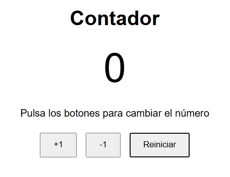

# Contador

Mi primer proyecto con JavaScript: una página web con un contador que se puede subir, bajar y reiniciar con tres botones, para practicar el DOM y los eventos.

## Captura

## Demo

[Ver el contador funcionando](https://jdanielrojasj.github.io/contador/)

## Tecnologías

- HTML
- CSS
- JavaScript

## Qué he aprendido

- Qué es el DOM: el árbol que el navegador crea a partir del HTML, y cómo JavaScript lo cambia para actualizar la pantalla sin tocar el archivo.
- Buscar elementos con `querySelector` y cambiar su texto con `textContent`.
- Reaccionar a los clics con `addEventListener`, pasando la función sin paréntesis para que se ejecute en cada clic y no solo al cargar la página.
- Cuándo usar `const` y cuándo `let`, y guardar el valor inicial en una constante para escribirlo en un solo sitio.
- Hacer commits pequeños con Git y revisar los cambios con `git diff` antes de guardarlos.